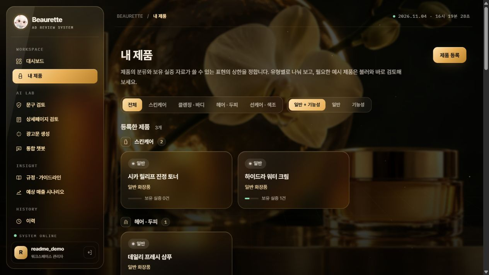
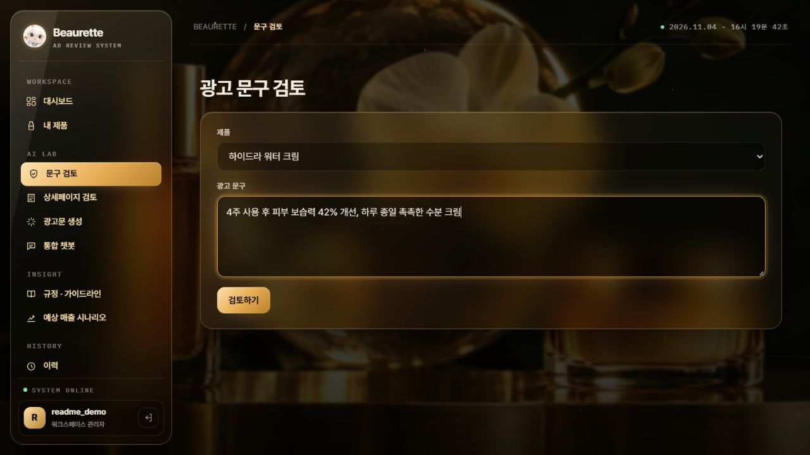
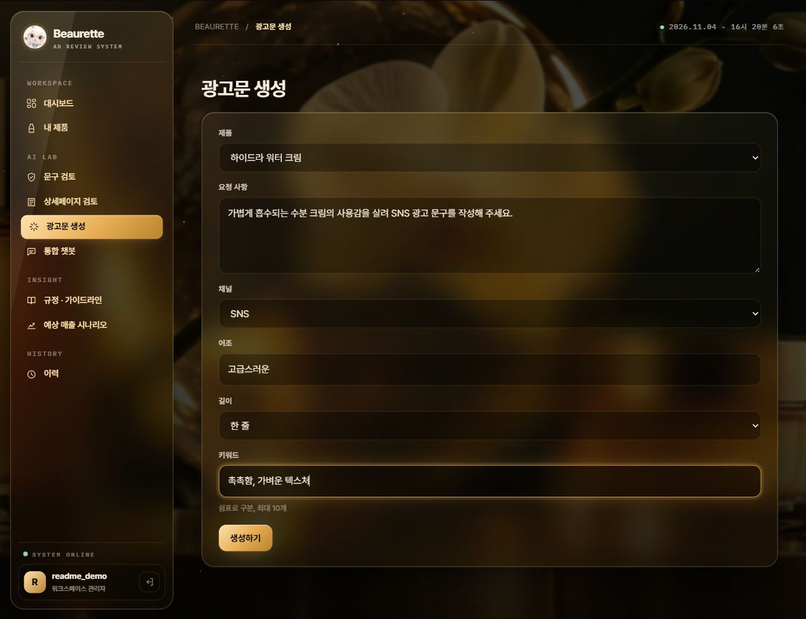
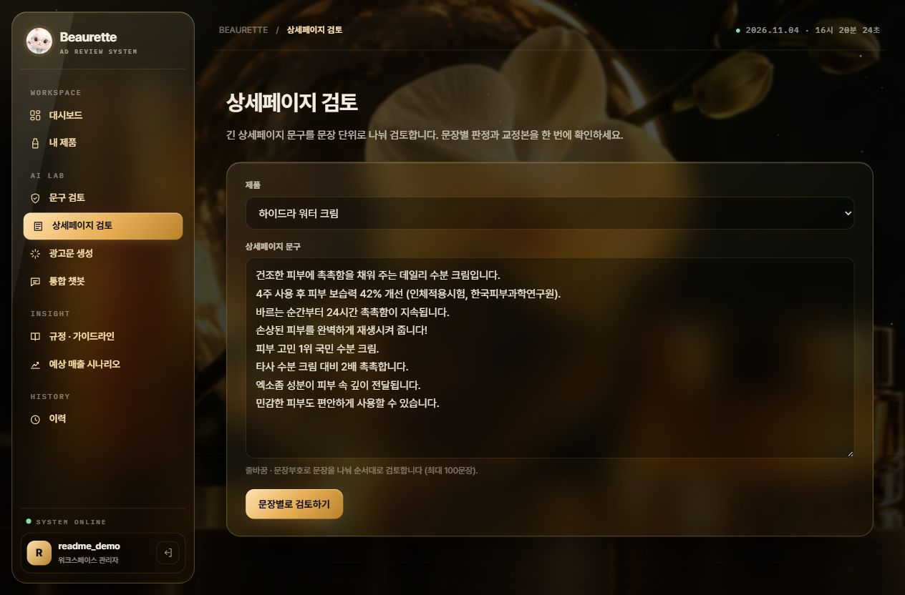
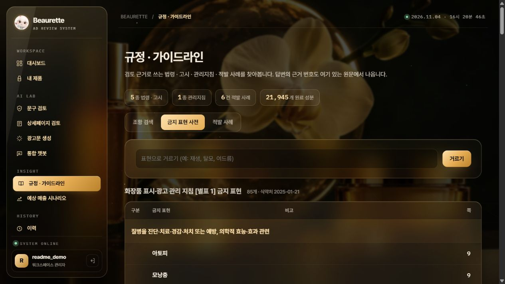
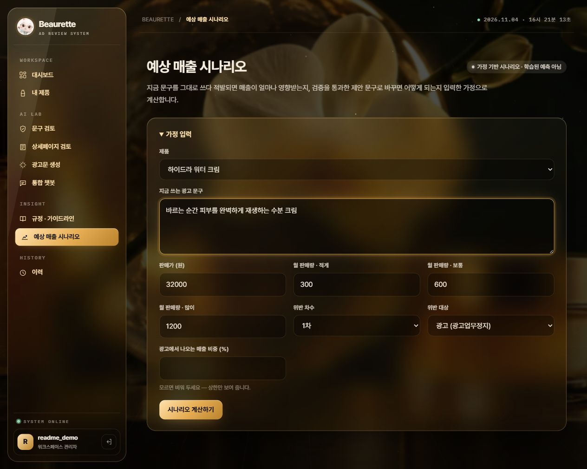
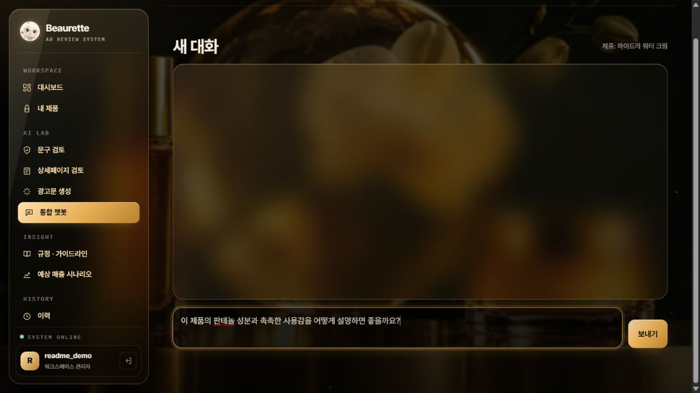
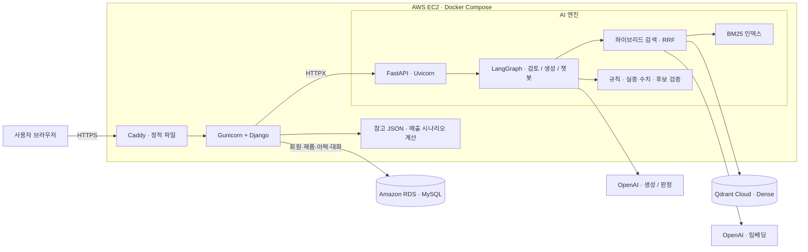
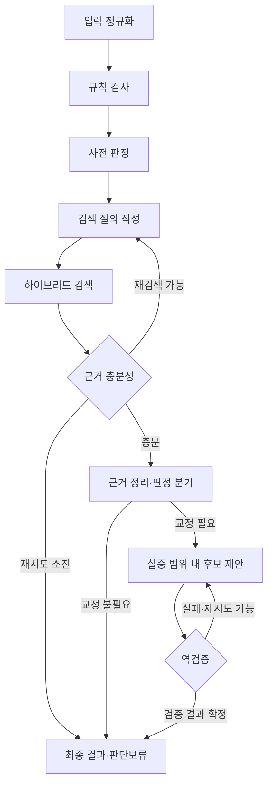

# Beaurette | 뷰렛

**화장품 광고 문구를 규정 근거로 검토하고, 회원별 제품·실증 자료와 검토·생성·대화 이력을 관리하는 AI 웹 서비스**

SK Networks Family AI Camp 35기 · **4차 프로젝트 · 5팀**

Django 웹에서 제품과 실증 자료를 관리하고, FastAPI · LangGraph · Qdrant 기반 RAG 엔진으로 광고 문구를 검토·교정·생성합니다. 상세페이지 일괄 검토, 규정 검색, 통합 챗봇과 예상 매출 시나리오를 하나의 화면 흐름으로 제공합니다.

**[서비스 바로가기](https://beaurette.duckdns.org)** · [주요 기능](#2-주요-기능) · [시스템 아키텍처](#3-시스템-아키텍처) · [데이터와 평가](#5-데이터와-평가)

[팀 저장소](https://github.com/SKNETWORKS-FAMILY-AICAMP/SKN35-4th-5Team) · [Django 웹 가이드](web/README.md) · [AI API 가이드](api/README.md) · [AWS 배포 가이드](docker/README.django.md) · [4차 역할 분담 계획서](plan.md)

<h2 align="center">🛠️ Tech Stack</h2>

<table align="center">
  <thead>
    <tr><th align="center">Category</th><th align="center">Technologies</th></tr>
  </thead>
  <tbody>
    <tr><td align="center"><strong>Languages</strong></td><td align="center">  </td></tr>
    <tr><td align="center"><strong>Backend &amp; UI</strong></td><td align="center">   </td></tr>
    <tr><td align="center"><strong>AI &amp; Agents</strong></td><td align="center">  </td></tr>
    <tr><td align="center"><strong>Database &amp; Search</strong></td><td align="center">    </td></tr>
    <tr><td align="center"><strong>Server &amp; Cloud</strong></td><td align="center">     </td></tr>
    <tr><td align="center"><strong>Tools &amp; Testing</strong></td><td align="center">   </td></tr>
  </tbody>
</table>

## 팀원 소개

<table align="center">
  <tbody>
    <tr>
      <td align="center" valign="middle" width="160"></td>
      <td align="center" valign="middle" width="160"></td>
      <td align="center" valign="middle" width="160"></td>
      <td align="center" valign="middle" width="160"></td>
    </tr>
    <tr>
      <td align="center"><strong>김경민</strong></td>
      <td align="center"><strong>권준호</strong></td>
      <td align="center"><strong>이형민</strong></td>
      <td align="center"><strong>이세희</strong></td>
    </tr>
  </tbody>
</table>

<p align="center"><sub>위 인물 이미지는 AI를 활용해 생성·편집한 팀원 소개용 이미지입니다.</sub></p>

### 4차 프로젝트 역할 및 기여

| 팀원 | 작업 브랜치 | 담당 영역 | 관련 코드 및 반영 내역 |
| --- | --- | --- | --- |
| **김경민** | [`kgm`](https://github.com/SKNETWORKS-FAMILY-AICAMP/SKN35-4th-5Team/tree/kgm) | AWS EC2 · RDS 배포, Docker Compose, Caddy · Gunicorn 운영 구성 | [`docker/`](docker/) · [`docker-compose.web.yml`](docker-compose.web.yml) · [Django/RDS 배포 구성](https://github.com/SKNETWORKS-FAMILY-AICAMP/SKN35-4th-5Team/commit/5035137) |
| **권준호** | [`kjh`](https://github.com/SKNETWORKS-FAMILY-AICAMP/SKN35-4th-5Team/tree/kjh) | 8개 섹션의 홈 화면, 공통 UI · 제품 필터, 상세페이지 검토 · 규정 열람 · 매출 시나리오 | [`web/templates/`](web/templates/) · [`web/static/`](web/static/) · [홈·공통 UI·추가 기능 구현](https://github.com/SKNETWORKS-FAMILY-AICAMP/SKN35-4th-5Team/commit/f5fe547) |
| **이형민** | [`lhm`](https://github.com/SKNETWORKS-FAMILY-AICAMP/SKN35-4th-5Team/tree/lhm) | Django 백엔드, 회원·제품·이력·대화 저장, AI 연동, 검증 실패 문구 차단, 예시 제품 불러오기 | [`web/`](web/) · [Django 웹 서비스 구현](https://github.com/SKNETWORKS-FAMILY-AICAMP/SKN35-4th-5Team/commit/4eb4d4a) · [검증 실패 문구 차단](https://github.com/SKNETWORKS-FAMILY-AICAMP/SKN35-4th-5Team/commit/b052390) · [예시 제품·실증 출처](https://github.com/SKNETWORKS-FAMILY-AICAMP/SKN35-4th-5Team/commit/8c9fad1) |
| **이세희** | [`lsh`](https://github.com/SKNETWORKS-FAMILY-AICAMP/SKN35-4th-5Team/tree/lsh) |  |  |

역할과 기여는 현재 저장소에 반영된 구현을 기준으로 정리했습니다. 공동 수정·통합된 기능은 주 기여 영역으로 표시했습니다.

---

## 서비스 화면

2026-11-04 기준 Django 웹 화면입니다. 홈·로그인은 배포 서비스에서, 로그인 후 기능 화면은 동일 코드의 로컬 환경에서 예시 제품과 별도 시연 계정으로 캡처했습니다. 입력 화면에는 실제 AI 실행 결과가 포함되어 있지 않습니다.

[](https://beaurette.duckdns.org)

| 로그인 | 내 제품·예시 제품 |
| :---: | :---: |
| [](docs/screenshots/web-login-2026-11-04.jpg) | [](docs/screenshots/web-products-2026-11-04.jpg) |
| 계정별 작업 공간 | 유형별 제품 목록·일반/기능성 필터 |

| 문구 검토 | 광고문 생성 |
| :---: | :---: |
| [](docs/screenshots/web-review-2026-11-04.jpg) | [](docs/screenshots/web-generate-2026-11-04.jpg) |
| 제품의 실증 자료를 반영한 검토 요청 | 채널·어조·길이·키워드 지정 |

| 상세페이지 검토 | 규정·가이드라인 |
| :---: | :---: |
| [](docs/screenshots/web-bulk-2026-11-04.jpg) | [](docs/screenshots/web-library-2026-11-04.jpg) |
| 긴 광고문을 문장별로 검토 | 조항 검색·금지 표현 사전·적발 사례 |

| 예상 매출 시나리오 | 통합 챗봇 |
| :---: | :---: |
| [](docs/screenshots/web-forecast-2026-11-04.jpg) | [](docs/screenshots/web-chat-2026-11-04.jpg) |
| 가격·판매량·광고 의존 비중을 입력 | 제품 맥락과 대화 내역 유지 |

## 1. 프로젝트 소개

화장품 광고는 같은 표현이라도 일반/기능성 제품 여부와 보유 시험 자료에 따라 검토 결과가 달라집니다. 규정 문서를 찾는 일과 실제로 사용할 수 있는 대체 문구를 만드는 일이 분리되어 있어, 마케터가 작성과 검토를 반복해야 합니다.

뷰렛은 **회원가입 → 내 제품·실증 자료 등록 → 문구 검토·광고문 생성 → 근거·수정 제안 확인 → 이력 조회**를 하나의 웹 서비스로 연결합니다. FastAPI와 LangGraph 기반 AI 엔진이 규정 검색·판정·교정·재검증을 수행하고, Django가 회원별 데이터와 화면을 관리합니다.

4차 프로젝트의 주제는 **LLM을 연동한 문서 기반 질의응답 웹 서비스 개발 및 배포**입니다. 회원 인증과 영속 저장, 브랜드 디자인을 반영한 Django 화면, 추가 분석 기능과 AWS 배포를 통합했습니다. 운영 구성은 EC2 · RDS MySQL · Caddy · Gunicorn이며, 로컬 개발은 SQLite를 사용합니다.

| 해결하려는 문제 | 구현 방식 |
| --- | --- |
| 판정 이유와 출처를 확인하기 어려움 | 법령·고시·지침·사례를 검색하고 조항 번호와 원문 스니펫 제공 |
| 같은 문구를 제품 맥락 없이 일괄 판정 | 제품 분류·기능성 유형·보유 실증 자료를 판정과 생성에 반영 |
| LLM이 수정하면서 위험 표현이나 숫자를 다시 생성 | 생성 결과를 규칙 엔진·실증 수치 검증기로 재검사 |
| 안전한 표현만 남기면서 광고의 구체성이 사라짐 | 제형·사용감·성분 역할·확인된 제품 사실을 생성 재료로 활용 |
| 제품·검토 결과를 계정별로 보관하고 다시 확인하기 어려움 | Django 인증과 DB 모델로 제품·실증·검토·생성·대화 이력 저장 |
| 웹 서비스와 AI 서버를 함께 운영해야 함 | Caddy → Django → FastAPI 구조와 Docker Compose, DB 준비 상태 점검 구성 |

이 서비스는 광고 사전 검토를 돕는 프로토타입입니다. 결과는 수집된 규정과 구현된 규칙에 기반한 검토 의견이며, 최종 법률 판단이나 광고 적합성 인증을 대신하지 않습니다.

## 2. 주요 기능

| 기능 | 구현 내용 |
| --- | --- |
| **홈·작업 공간** | 8개 섹션을 넘기는 랜딩 화면, 금빛·유리 질감의 공통 UI, 기능별 사이드바와 대시보드 |
| **회원가입·로그인** | Django 기본 인증, 회원별 제품·검토·생성·대화 접근 제한 |
| **제품·실증 자료 관리** | 제품과 시험 자료 등록·수정·삭제, 제품 유형별 목록과 일반/기능성 필터 |
| **예시 제품 불러오기** | 23개 예시 제품을 내 제품으로 복사, 보유 시험 보고서와 공식몰 공개 요약의 출처 구분 |
| **문구 검토·교정** | 가능·조건부·불가 또는 판단보류, 위반 유형·근거 조항·추가 시험 안내, 검증을 통과한 수정 제안 |
| **상세페이지 검토** | 최대 50,000자·100문장을 순차 검토, 문장별 판정·근거·수정 후보·판정 집계와 교정본 제공 |
| **광고문 생성** | 제품·채널·어조·길이·키워드 기반 후보 생성, 검토 상태·사유 표시, 제외 후보 숨김 |
| **통합 챗봇** | 제품별 대화방, 검토·생성·화장품/성분 질문 분기, 메시지·대화 맥락 저장 및 최근 12개 메시지 전달 |
| **규정·가이드라인** | 일반/기능성 범위별 조항 검색, 관리지침 금지 표현 사전, 적발 사례 열람 |
| **예상 매출 시나리오** | 가격·판매량·위반 차수·광고 의존 비중을 바탕으로 월 매출, 처분 시 영향 범위, 문구 변경 시 변화 폭 계산·시각화 |
| **검토·생성 이력** | 입력과 AI 응답 저장, 목록·상세 조회, 제품별 검토 이력 필터링 |
| **운영 상태 점검** | AI 연결 진단, DB 연결·미적용 마이그레이션 검사 |

### 사용 흐름

1. **회원가입·로그인** 후 내 작업 공간에 접속합니다.
2. **제품 직접 등록 또는 예시 제품 불러오기**로 제품 정보와 실증 자료를 준비합니다.
3. **문구 검토·상세페이지 검토·광고문 생성**에서 제품을 선택하고 요청을 입력합니다.
4. **판정·근거·후보 상태 확인** 후 필요한 자료를 보완하거나 문구를 다시 작성합니다.
5. **규정 검색·매출 시나리오·챗봇**으로 관련 근거와 가정을 추가로 확인합니다.
6. **검토·생성 이력과 대화방**에서 저장된 작업을 다시 확인합니다.

### 저장 범위와 결과 해석

회원·제품·실증 자료·단일 문구 검토·광고문 생성·대화방·메시지는 DB에 저장합니다. 상세페이지 일괄 검토, 규정 검색, 예상 매출 시나리오는 현재 요청의 결과를 화면에 표시하며 별도 이력 모델은 없습니다.

예시 제품에는 시연용 자료와 공개 분석 자료가 포함되어 있습니다. 공식몰 공개 요약은 원보고서 확보 여부를 표시하며, 시장 광고나 성분의 일반적인 설명을 자사 완제품의 효능 실증으로 간주하지 않습니다. 매출 수치는 입력 가정에 따른 시나리오이며 실제 판매 성과나 상승률을 보장하지 않습니다.

## 3. 시스템 아키텍처

Django가 인증·화면·DB 저장·시나리오 계산을 담당하고, FastAPI가 규정 검색과 AI 검토·생성·대화 요청을 처리합니다.



`docker-compose.web.yml`은 `proxy`, `web`, `api`를 실행합니다. Caddy가 HTTPS와 정적 파일을 제공하고 Gunicorn은 Docker 내부에서 Django를 실행합니다. RDS와 Qdrant Cloud는 외부 관리형 DB를 사용하며, 로컬에서는 Django 개발 서버·SQLite로 실행합니다.

| 데이터 흐름 | 처리 |
| --- | --- |
| 제품 → AI 요청 | `Product`·`Evidence`를 `ProductCard` 형식으로 변환 |
| 검토·생성 → 이력 | Django가 FastAPI 응답의 요약 필드와 원문 JSON 저장 |
| 챗봇 → 다음 대화 | 메시지와 응답 맥락을 저장하고 다음 요청에 전달 |
| 규정·시나리오 | AI 검색·판정 결과와 `web/core/reference/`의 고정 참고 자료 활용 |

실행·환경변수는 [Django 웹 가이드](web/README.md), 운영 설정·마이그레이션·도메인 HTTPS는 [AWS 배포 가이드](docker/README.django.md)를 참고하세요.

### 검토 워크플로


<details>
<summary>상세 분기 보기 (Mermaid)</summary>



</details>

검토 그래프는 9개 노드로 구성하고 재검색·재제안 횟수를 제한합니다. 최종 단계에서 검증 통과 후보만 남기고, 최종 수정안이 검증에 실패하면 제안을 비우고 안내를 반환합니다. 생성 그래프는 별도로 구성하되 같은 규칙 엔진과 검증기를 재사용합니다. 조건부·불가 판정에는 근거 조항을, 조건부 판정에는 필요한 추가 시험을 포함하도록 Pydantic 응답 계약을 검증합니다.

## 4. 핵심 구현과 기술적 의사결정

### 공통 디자인과 기능 화면 통합

로그인 전에는 8개 섹션의 랜딩 화면으로 서비스·검토 사례·근거 자료를 소개합니다. 로그인 후에는 대시보드, 제품, AI 기능, 분석, 이력을 공통 사이드바로 연결합니다. 템플릿·CSS·JavaScript와 한글 폰트·브랜드 자산을 `web/`에 포함해 Django 배포 이미지에서 제공합니다.

구현: [`landing_jarvis.html`](web/templates/core/landing_jarvis.html) · [`base.html`](web/templates/base.html) · [`app.css`](web/static/css/app.css) · [`studio_views.py`](web/core/studio_views.py)

### 예시 제품과 실증 자료의 출처 보존

23개 예시 제품을 회원 소유의 제품과 실증 자료로 복사합니다. 같은 계정에서 이미 불러온 예시는 기존 제품으로 연결합니다. `source_kind`와 `source_url`로 보유 시험 보고서와 공식몰 공개 요약을 구분하고, AI 서버에 출처 정보를 전달합니다.

구현: [`samples.py`](web/products/samples.py) · [`sample_products.json`](web/products/sample_products.json) · [`제품·실증 모델`](web/products/models.py)

### 검증 실패 문구의 최종 노출 제어

검토 워크플로는 최종 `candidates`에 검증 통과 문구만 남깁니다. 수정안의 최종 검증이 실패하면 `suggestion`을 비우며, 화면에는 대체 문구 대신 안내와 탈락 사유를 표시합니다. 광고문 생성에서는 `제외` 후보를 숨기고 `확인필요` 후보에는 경고를 붙입니다. 챗봇도 해당 상태 구분을 반영합니다.

구현: [`workflow/nodes.py`](src/cosmetic_agent/workflow/nodes.py) · [`검토 결과 화면`](web/templates/reviews/review_detail.html) · [`생성 이력 모델`](web/reviews/models.py) · [`챗봇 표시`](web/static/js/chat.js)

### 매출 시나리오의 가정과 계산 분리

AI 서버의 판정과 법령 근거 ID를 받아 판매가·월 판매량·위반 차수·광고 의존 비중을 입력값으로 계산합니다. 월 매출 범위, 처분 시 영향받는 매출의 추정치 또는 상한, 문구 교체 시 변화 폭을 카드·차트·표로 보여줍니다. 처분 기준 연결이 불충분한 경우 개별 검토 상태로 표시합니다.

구현: [`revenue_scenario.py`](web/core/revenue_scenario.py) · [`forecast.html`](web/templates/core/forecast.html) · [`forecast-dash.js`](web/static/js/forecast-dash.js)

### 웹 서비스와 AI 서버 분리

Django는 [`core/ai_client.py`](web/core/ai_client.py)를 통해 FastAPI를 호출합니다. 제품·실증 모델을 AI 요청 형식으로 변환하고, 정상 응답은 검토·생성 이력에 저장합니다. 연결 실패·시간 초과·API 오류는 사용자 메시지로 처리하며 실패 요청은 이력으로 저장하지 않습니다.

제품·검토·생성·대화 조회는 로그인 사용자 기준으로 제한합니다. 챗봇은 메시지와 AI 응답의 맥락을 DB에 저장해 다음 요청에 활용합니다.

구현: [`products/`](web/products/) · [`reviews/`](web/reviews/) · [`chat/`](web/chat/)

### 영속 저장과 배포 준비 상태 확인

개발 환경은 SQLite, 운영 구성은 RDS MySQL을 사용하며 PostgreSQL도 지원합니다. 운영 설정에서는 DB 연결 정보와 50자 이상의 비밀키가 필요하고, RDS 연결 시 인증서와 호스트명을 검증합니다. 스키마 변경은 배포 과정에서 명시적으로 적용하며 `/health/ready/`가 DB 연결과 미적용 마이그레이션을 확인합니다.

Caddy가 HTTPS와 정적 파일을 제공하고 Gunicorn은 Docker 내부에서 Django를 실행합니다. 구성과 실행 순서는 [Django/RDS 배포 가이드](docker/README.django.md)를 따릅니다.

### 하이브리드 검색과 출처 보존

- 원문을 조항 단위로 나누고 출처·조항·법적 효력·제품 범위를 메타데이터로 보존합니다.
- OpenAI 임베딩 기반 Dense 검색과 BM25 검색을 가중 RRF로 결합합니다.
- 검색용 설명·키워드를 색인에 보강하되, 사용자에게 인용하는 문장은 규정 원문을 사용합니다.
- 검토 검색은 기본 Top 4를 사용하고 경량 reranker로 내부 순서를 조정합니다. 생성 흐름은 별도 검색 개수를 사용합니다.
- Dense 검색에 실패하면 BM25로 검색을 이어가며, 근거가 부족하면 판단보류 경로를 사용합니다.

구현: [`rag/`](src/cosmetic_agent/rag/) · [`indexing/`](indexing/) · [검색 설정](configs/retrieval.yaml)

### 규칙 판정을 하한으로 두는 구조

규칙·GPT zero-shot·few-shot을 동일 개발셋에서 비교한 결과, GPT의 정상 문구 과잉 경고와 불가→조건부 완화가 확인됐습니다. 기본 판정 백엔드는 `rule`로 두고, GPT를 사용하는 경우에도 명확한 규칙 위반과 실증 수치 충돌을 더 낮은 위험도로 덮어쓰지 않도록 구성했습니다.

구현: [`rules.py`](src/cosmetic_agent/domain/rules.py) · [`gpt_judge.py`](src/cosmetic_agent/models/gpt_judge.py) · [판정 평가 보고서](eval/reports/dev_comparison_2026-10-13.md)

### 실증 수치의 잘못된 조합 차단

모든 시험의 숫자를 합쳐 비교하면 서로 다른 시험의 기간·수치를 조합한 문구가 통과할 수 있습니다. 이를 막기 위해 한 문장의 수치와 기간이 **같은 효능의 단일 시험 기록**에 함께 존재하는지 확인합니다. 시험기관 이름의 숫자는 효능 결과로 인정하지 않습니다.

예: 보습 시험의 `4주·35%`와 탄력 시험의 `2주·70%`를 이용해 `2주 보습력 70% 개선`을 만드는 경우를 차단합니다.

구현: [`verifier.py`](src/cosmetic_agent/domain/verifier.py) · [회귀 테스트](tests/unit/test_review_regressions.py)

### 생성과 검증의 분리

LLM은 확인된 제품 사실·성분 역할·시장 표현을 재료로 후보를 작성하고, 코드가 금지 표현·기능성 범위·실증 수치를 다시 검사합니다. 검증 실패 사유는 재작성 입력에 반영합니다. 후보 선별에는 표현 매력도 평가도 활용하지만, 매출 상승이나 실제 광고 성과를 보장하는 점수로 해석하지 않습니다.

구현: [`generation/`](src/cosmetic_agent/generation/) · [`copy_suggester.py`](src/cosmetic_agent/models/copy_suggester.py) · [`appeal_ranker.py`](src/cosmetic_agent/models/appeal_ranker.py)

## 5. 데이터와 평가

### Django 웹 검증

**2026-11-04, 현재 코드의 Django 테스트 36개 통과.** 별도 SQLite 테스트 DB와 AI 응답 대역을 사용했으며, 시스템 검사에서도 문제가 발견되지 않았습니다.

| 검증 영역 | 주요 항목 |
| --- | --- |
| 회원·제품 | 로그인 필요 페이지, 타인 제품 접근 제한, 예시 제품 복사·형식·출처 |
| 검토·생성·챗봇 | 이력 저장, 검증 통과 수정안이 없을 때 안내, AI 오류 처리, 메시지·맥락 보존 |
| 추가 기능 화면 | 상세페이지 문장별 결과·교정본, 규정 검색·사전·사례, 매출 가정·법령 근거 연결 |
| 운영 설정 | 강한 비밀키·운영 DB 요구, RDS TLS 설정, DB·마이그레이션 readiness |

테스트 코드: [`tests.py`](web/core/tests.py) · [`test_studio.py`](web/core/test_studio.py) · [`test_deployment.py`](web/core/test_deployment.py). 실행 방법은 [웹 테스트 안내](web/README.md#테스트)를 참고하세요. 이 결과는 실제 OpenAI·Qdrant·RDS 통합 성능이나 부하 시험 결과를 의미하지 않습니다.

아래 AI 평가 수치는 저장된 보고서의 측정 시점을 유지했습니다. 웹 기능 테스트와 별도로 읽어야 합니다.

### 데이터 구성

| 구분 | 내용 | 상세 문서 |
| --- | --- | --- |
| 규정 원문 | 법령·고시 5종, 관리지침 1종, 적발 사례 6건 | [원본 데이터](data/01_raw/README.md) |
| 검색 데이터 | 조항 청크·검색 메타데이터, Qdrant 및 BM25 인덱스 | [`data/02_processed/`](data/02_processed/) |
| 규칙 자산 | 금지 표현·기능성 범위·표현 단계·제품 예시 | [`data/assets/`](data/assets/) |
| 판정 벤치마크 | 팀 작성 dev 45문항·holdout 21문항 | [`data/golden_set/`](data/golden_set/) |
| 성분 지식 | 원료성분 21,945개와 생성·설명용 참고 자료 | [성분 지식](data/ingredient_knowledge/README.md) |
| 시장·표현 참고 | 시장 제품·광고 문구·표현 은행 | [시장 자료](data/market_reference/README.md) · [표현 은행](data/copy_bank/README.md) |
| 웹 예시 제품 | 회원별 복사·편집이 가능한 23개 제품 | [`예시 제품`](web/products/sample_products.json) |
| 시나리오 참고 | 공개 비교 실험·처분 기준·문구 효과 크기 자료 | [매출 시나리오 자료](data/sales_forecast_reference/README.md) |

원본 문서의 버전·수집 내역·출처는 각 데이터 문서에 기록합니다. 규칙 자산을 변경할 때는 [`scripts/build_rule_assets.py`](scripts/build_rule_assets.py)를 수정한 뒤 다시 생성합니다.

### 판정 백엔드 비교

2026-10-13 저장 보고서 기준, 팀 작성 **dev 45문항**에 대한 독립 사전 판정 결과입니다. 검색·교정·역검증을 포함한 전체 서비스 평가는 아닙니다.

| 지표 | Rule | GPT zero-shot | GPT few-shot |
| --- | ---: | ---: | ---: |
| 수준 정확도 | 100.0% (45/45) | 68.9% (31/45) | 73.3% (33/45) |
| Macro-F1 (0/1/2 고정) | 1.000 | 0.639 | 0.612 |
| 불가→가능 오류 | 0건 | 0건 | 0건 |
| 불가→조건부 오류 | 0건 | 6건 | 1건 |
| 정상 문구 과잉 경고 | 0.0% | 50.0% | 66.7% |

규칙 개발에 사용한 소규모 개발셋이므로 Rule의 100%를 미관측 문구에 대한 성능으로 일반화할 수 없습니다. few-shot은 전체 정확도를 높였지만 정상 문구 과잉 경고도 늘려 Macro-F1은 낮아졌습니다.

출처: [판정 비교 보고서 및 오류 분석](eval/reports/dev_comparison_2026-10-13.md)

### 검색 방식 비교

2026-10-14 저장 보고서 기준입니다. 검색 인덱스는 59개 청크이며, 필수 인용 정답이 있는 dev 33문항·holdout 16문항만 검색 지표에 포함했습니다.

| 평가셋 | 검색 방식 | Strict Hit@4 | Evidence Coverage@4 | MRR |
| --- | --- | ---: | ---: | ---: |
| dev (33) | Dense | 42.4% | 66.7% | 0.3351 |
| dev (33) | BM25 | 57.6% | 81.8% | 0.4904 |
| dev (33) | **Hybrid** | **69.7%** | **81.8%** | **0.5404** |
| holdout 회귀셋 (16) | Dense | 43.8% | 56.2% | 0.4376 |
| holdout 회귀셋 (16) | BM25 | 50.0% | 93.8% | 0.4062 |
| holdout 회귀셋 (16) | **Hybrid** | **75.0%** | **100.0%** | **0.4369** |

- **Strict Hit@4**: 지정된 필수 근거가 상위 4개 결과에 포함된 비율입니다.
- **Evidence Coverage@4**: 필수 근거 또는 평가셋이 허용한 관련 근거가 포함된 비율입니다. 최종 답변의 법적 정확도나 충분성을 뜻하지 않습니다.
- **MRR**: 첫 필수 근거의 순위 역수 평균입니다.

holdout은 반복 실행하는 고정 회귀셋으로 사용했으므로 블라인드 최종 성능으로 제시하지 않습니다. 표는 해당 날짜에 저장된 결과이며 이후 코드 변경의 성능을 보증하지 않습니다.

출처: [dev 검색 보고서](eval/reports/rag_retrieval_dev_2026-10-14.md) · [holdout 검색 보고서](eval/reports/rag_retrieval_holdout_2026-10-14.md)


## 6. 디렉토리 구조

```text
├── api/                       # FastAPI 라우트·요청 처리
├── web/                       # 4차 Django 웹 서비스 (별도 uv 프로젝트)
│   ├── config/                # Django 설정·URL·WSGI
│   ├── core/                  # 홈·일괄 검토·규정·시나리오·AI 클라이언트
│   │   └── reference/         # 관리지침·적발 사례·처분 기준 등 고정 참고 자료
│   ├── accounts/              # 회원가입·로그인·로그아웃
│   ├── products/              # 사용자별 제품·실증·예시 제품 불러오기
│   ├── reviews/               # 검토·생성 요청과 이력
│   ├── chat/                  # 대화방·메시지·대화 맥락
│   ├── templates/             # Django HTML 템플릿
│   ├── static/                # CSS·JavaScript·폰트·브랜드 자산
│   └── scripts/               # 참고 자료 내보내기·랜딩 화면 생성
├── app/                       # 기존 Streamlit 참고 앱
├── configs/                   # 판정·검색·재시도 설정
├── data/
│   ├── 01_raw/                # 규정·사례·원료성분 원본
│   ├── 02_processed/          # 조항 청크·BM25 인덱스
│   ├── assets/                # 규칙·표현 단계·제품 자산
│   ├── golden_set/            # 팀 작성 판정 벤치마크
│   ├── ingredient_knowledge/  # 성분 참고 지식
│   ├── market_reference/      # 시장 제품·문구 참고
│   ├── copy_bank/             # 표현 은행
│   └── sales_forecast_reference/ # 시나리오·공개 비교 실험 자료
├── indexing/                  # 원문 청킹·메타데이터·색인 생성
├── src/cosmetic_agent/
│   ├── common/                # 환경설정·로깅·예외
│   ├── domain/                # 스키마·규칙·실증 검증
│   ├── rag/                   # Dense·BM25·RRF·reranker
│   ├── models/                # 판정·교정·생성·챗봇 모델
│   ├── workflow/              # 검토 LangGraph
│   ├── generation/            # 생성 LangGraph
│   └── service.py             # 검토 서비스 진입점
├── eval/                      # 판정 평가·저장 보고서
├── tests/                     # 단위·통합 테스트
├── scripts/                   # 데이터 구축·검색 평가·배포 보조
├── docker/                    # API·웹 이미지, Caddy, 운영 환경변수·배포 안내
├── docker-compose.web.yml     # 4차 Django + FastAPI + Caddy 배포
├── docker-compose.yml         # 기존 FastAPI + Streamlit 실행
├── docs/                      # 참고 화면·다이어그램·이전 계획서
├── finetune/                  # 향후 파인튜닝 실험 골격
└── plan.md                    # 4차 역할 분담·일정·테스트 계획
```
