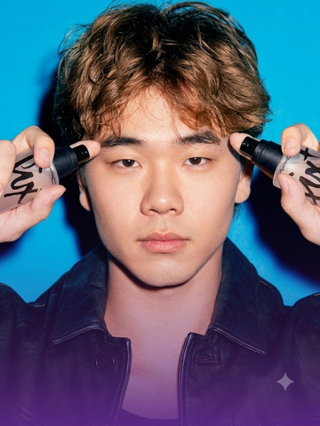
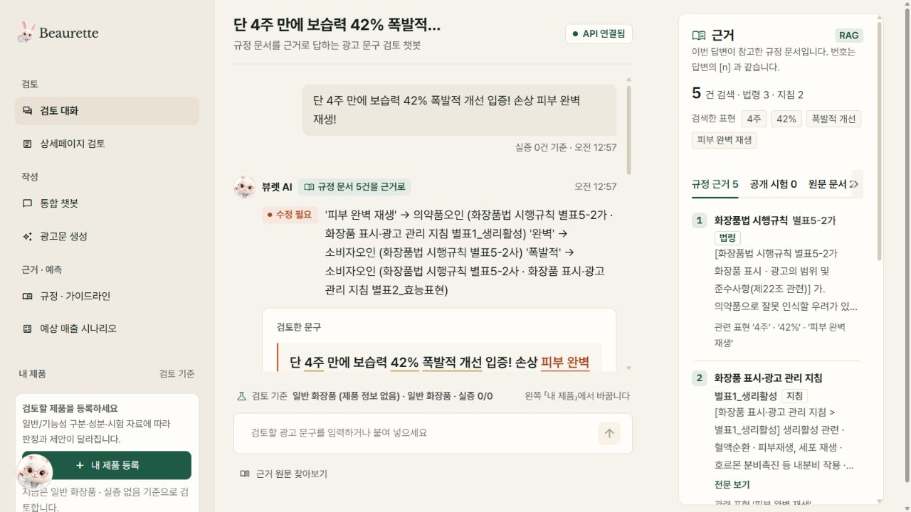
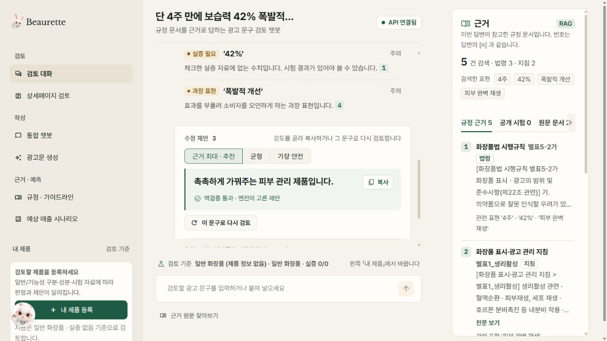
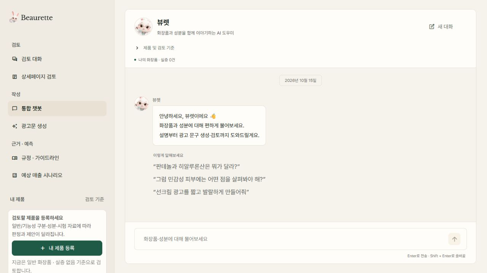
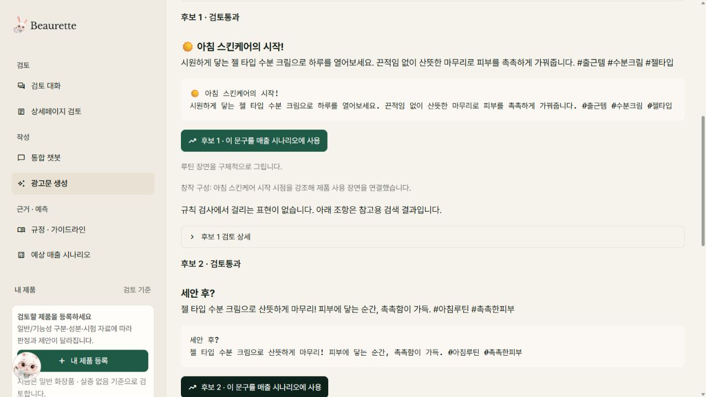
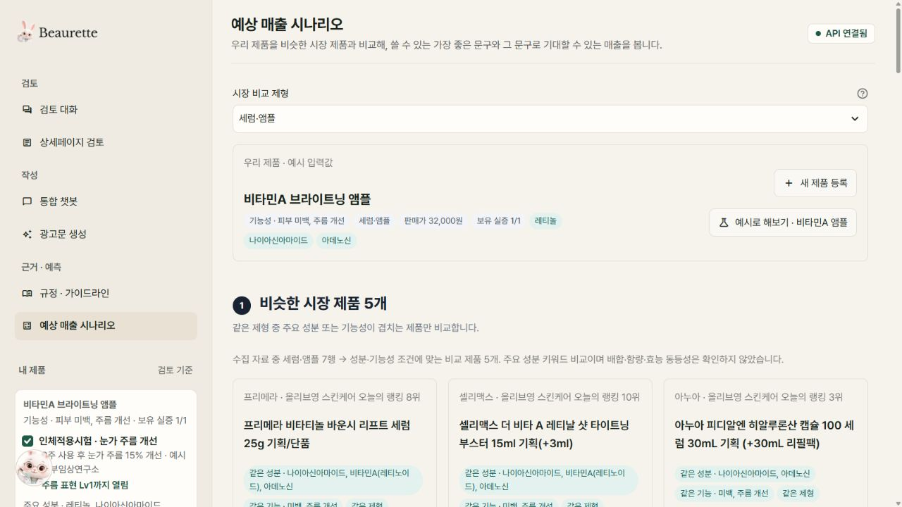
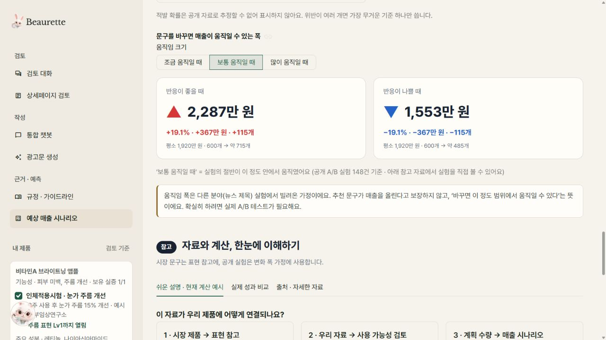
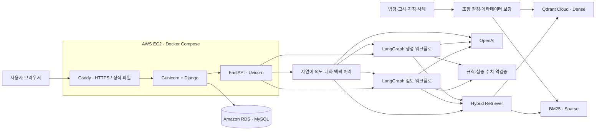
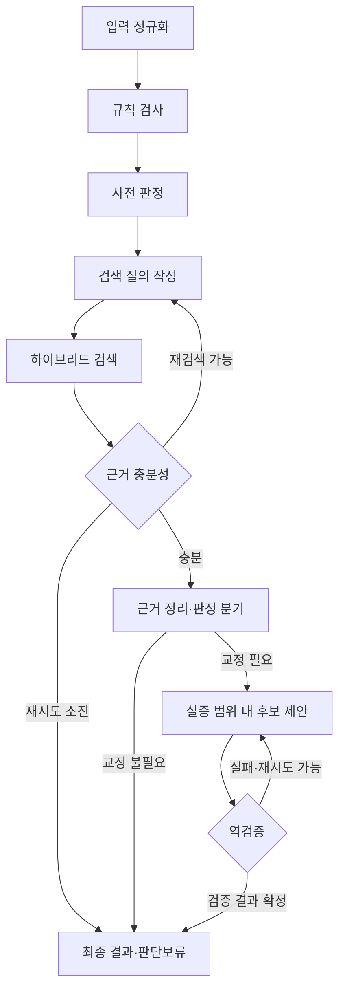

# Beaurette | 뷰렛

**화장품 광고 문구를 규정 근거로 검토하고, 회원별 제품·실증 자료와 검토·생성·대화 이력을 관리하는 AI 웹 서비스**

SK Networks Family AI Camp 35기 · **4차 프로젝트 · 5팀**

기존 RAG 에이전트를 FastAPI AI 서버로 활용하고, Django 웹 서비스와 AWS EC2 · RDS 배포 구성을 더했습니다.

[팀 저장소](https://github.com/SKNETWORKS-FAMILY-AICAMP/SKN35-4th-5Team) · [Django 웹 가이드](web/README.md) · [AI API 가이드](api/README.md) · [AWS 배포 가이드](docker/README.django.md) · [4차 역할 분담 계획서](plan.md)

<h2 align="center">🛠️ Tech Stack</h2>

<table align="center">
  <thead>
    <tr><th align="center">Category</th><th align="center">Technologies</th></tr>
  </thead>
  <tbody>
    <tr><td align="center"><strong>Languages</strong></td><td align="center">  </td></tr>
    <tr><td align="center"><strong>Backend &amp; UI</strong></td><td align="center">   </td></tr>
    <tr><td align="center"><strong>AI &amp; Agents</strong></td><td align="center">  </td></tr>
    <tr><td align="center"><strong>Database &amp; Search</strong></td><td align="center">    </td></tr>
    <tr><td align="center"><strong>Server &amp; Cloud</strong></td><td align="center">     </td></tr>
    <tr><td align="center"><strong>Tools &amp; Testing</strong></td><td align="center">   </td></tr>
  </tbody>
</table>

## 팀원 소개

<table align="center">
  <tbody>
    <tr>
      <td align="center" valign="middle" width="160"></td>
      <td align="center" valign="middle" width="160"></td>
      <td align="center" valign="middle" width="160"></td>
      <td align="center" valign="middle" width="160"></td>
    </tr>
    <tr>
      <td align="center"><strong>김경민</strong></td>
      <td align="center"><strong>권준호</strong></td>
      <td align="center"><strong>이형민</strong></td>
      <td align="center"><strong>이세희</strong></td>
    </tr>
  </tbody>
</table>

<p align="center"><sub>위 인물 이미지는 AI를 활용해 생성·편집한 팀원 소개용 이미지입니다.</sub></p>

### 4차 프로젝트 역할 및 기여

| 팀원 | 작업 브랜치 | 담당 영역 | 관련 코드 및 반영 내역 |
| --- | --- | --- | --- |
| **김경민** | [`kgm`](https://github.com/SKNETWORKS-FAMILY-AICAMP/SKN35-4th-5Team/tree/kgm) | AWS EC2 · RDS 배포, Docker Compose, Caddy · Gunicorn 운영 구성 | [`docker/`](docker/) · [`docker-compose.web.yml`](docker-compose.web.yml) · [Django/RDS 배포 구성](https://github.com/SKNETWORKS-FAMILY-AICAMP/SKN35-4th-5Team/commit/5035137) |
| **권준호** | [`kjh`](https://github.com/SKNETWORKS-FAMILY-AICAMP/SKN35-4th-5Team/tree/kjh) | Django 템플릿 · CSS · JavaScript, 기존 브랜드 디자인의 웹 화면 이식 | 담당 경로: [`web/templates/`](web/templates/) · [`web/static/`](web/static/) |
| **이형민** | [`lhm`](https://github.com/SKNETWORKS-FAMILY-AICAMP/SKN35-4th-5Team/tree/lhm) | Django 백엔드, 회원·제품·실증·이력 모델, AI 서버 연동, 브랜치 통합 | [`web/`](web/) · [Django 웹 서비스 구현](https://github.com/SKNETWORKS-FAMILY-AICAMP/SKN35-4th-5Team/commit/4eb4d4a) · [환경변수 처리 보완](https://github.com/SKNETWORKS-FAMILY-AICAMP/SKN35-4th-5Team/commit/814fd0a) |
| **이세희** | [`lsh`](https://github.com/SKNETWORKS-FAMILY-AICAMP/SKN35-4th-5Team/tree/lsh) |  |  |

담당 영역은 [4차 역할 분담 계획서](plan.md), 반영 내역은 현재 저장소의 구현 커밋을 기준으로 정리했습니다. 담당 경로는 작업 범위를 나타내며, 해당 경로의 모든 코드를 개인 단독 기여로 의미하지 않습니다.

---

<details>
<summary>기존 Streamlit 기능 참고 화면 (2026-10-15)</summary>

아래 이미지는 기존 Streamlit 앱의 기능 참고 자료입니다. 4차 Django 웹 화면과는 다르며, 현재 웹 서비스의 실행 방법과 화면 구성은 [Django 웹 가이드](web/README.md)를 참고하세요. 이미지를 누르면 원본 크기로 볼 수 있습니다.

[](docs/screenshots/home-2026-10-15.jpg)

| 문구 검토 · 규정 근거 | 수정 후보 · 역검증 |
| :---: | :---: |
| [](docs/screenshots/review-2026-10-15.jpg) | [](docs/screenshots/review-candidates-2026-10-15.jpg) |
| 문제 표현과 연결된 규정 원문 확인 | 근거 최대·균형·가장 안전 후보 선택 |

| 통합 챗봇 | 광고문 생성 |
| :---: | :---: |
| [](docs/screenshots/chat-2026-10-15.jpg) | [](docs/screenshots/generate-2026-10-15.jpg) |
| 화장품·성분 Q&A부터 생성·검토까지 | 검토를 통과한 후보 확인 및 매출 시나리오 연결 |

| 내 제품 · 시장 비교 | 예상 매출 시나리오 |
| :---: | :---: |
| [](docs/screenshots/market-2026-10-15.jpg) | [](docs/screenshots/forecast-2026-10-15.jpg) |
| 예시 제품의 성분·기능성·제형을 기준으로 비교 | 입력 가정에 따른 변화 범위 확인 |

검토·광고문 생성 이미지는 실제 API 실행 결과입니다. 시장 비교·매출 화면은 앱에서 제공하는 비타민A 앰플 예시를 사용했으며, 표시된 판매량과 매출 변화는 가정 기반 시나리오입니다.

</details>

## 1. 프로젝트 소개

화장품 광고는 같은 표현이라도 일반/기능성 제품 여부와 보유 시험 자료에 따라 검토 결과가 달라집니다. 규정 문서를 찾는 일과 실제로 사용할 수 있는 대체 문구를 만드는 일이 분리되어 있어, 마케터가 작성과 검토를 반복해야 합니다.

뷰렛은 **회원가입 → 내 제품·실증 자료 등록 → 문구 검토·광고문 생성 → 근거·수정 제안 확인 → 이력 조회**를 하나의 웹 서비스로 연결합니다. FastAPI와 LangGraph 기반 AI 엔진이 규정 검색·판정·교정·재검증을 수행하고, Django가 회원별 데이터와 화면을 관리합니다.

4차 프로젝트는 **LLM을 연동한 문서 기반 질의응답 웹 서비스 개발 및 배포**에 초점을 둡니다. 현재 저장소에는 Django 웹 앱과 AWS EC2용 Docker Compose 구성이 포함되어 있으며, 운영 DB는 RDS MySQL, 웹 진입점은 Caddy · Gunicorn을 사용하도록 구성했습니다. 로컬 개발은 SQLite를 사용합니다.

| 해결하려는 문제 | 구현 방식 |
| --- | --- |
| 판정 이유와 출처를 확인하기 어려움 | 법령·고시·지침·사례를 검색하고 조항 번호와 원문 스니펫 제공 |
| 같은 문구를 제품 맥락 없이 일괄 판정 | 제품 분류·기능성 유형·보유 실증 자료를 판정과 생성에 반영 |
| LLM이 수정하면서 위험 표현이나 숫자를 다시 생성 | 생성 결과를 규칙 엔진·실증 수치 검증기로 재검사 |
| 안전한 표현만 남기면서 광고의 구체성이 사라짐 | 제형·사용감·성분 역할·확인된 제품 사실을 생성 재료로 활용 |
| 제품·검토 결과를 계정별로 보관하고 다시 확인하기 어려움 | Django 인증과 DB 모델로 제품·실증·검토·생성·대화 이력 저장 |
| 웹 서비스와 AI 서버를 함께 운영해야 함 | Caddy → Django → FastAPI 구조와 Docker Compose, DB 준비 상태 점검 구성 |

이 서비스는 광고 사전 검토를 돕는 프로토타입입니다. 결과는 수집된 규정과 구현된 규칙에 기반한 검토 의견이며, 최종 법률 판단이나 광고 적합성 인증을 대신하지 않습니다.

## 2. 주요 기능

| 기능 | 제공 내용 |
| --- | --- |
| **회원가입·로그인** | Django 기본 인증, 로그인 사용자별 제품·검토·생성·대화 접근 제한 |
| **내 제품·실증 자료 관리** | 제품과 보유 실증 자료 등록·조회·수정·삭제, AI 서버의 ProductCard 형식으로 변환 |
| **단일 문구 검토** | 가능·조건부·불가 판정, 문제 표현, 근거 조항, 추가로 필요한 시험 안내 |
| **교정 후보 제안** | 제품의 실증 범위에 따른 수정 제안과 AI 서버의 재검증 결과 확인 |
| **광고문 생성** | 작성 요청·채널·어조·제품 정보를 반영하고, 규정 검색·후보 검증·필요 시 재작성 |
| **검토·생성 이력** | 사용자별 입력과 AI 응답 저장, 목록·상세 조회, 제품별 검토 이력 필터링 |
| **통합 챗봇** | 대화방·메시지·맥락 저장, 최근 12개 메시지 전달, 검토·생성·화장품/성분 Q&A 분기 |
| **운영 상태 점검** | AI 연결 상태와 DB 연결·미적용 마이그레이션 점검 경로 제공 |

상세페이지 일괄 검토와 규정 검색은 AI API에 남아 있습니다. 시장 비교·매출 시나리오 등 기존 Streamlit 화면의 기능은 [기존 UI 가이드](app/README.md)에 정리되어 있으며, 현재 Django 웹 화면에는 별도로 연결되어 있지 않습니다.

### 사용 흐름

1. **회원가입·로그인**: 내 계정으로 웹 서비스에 접속합니다.
2. **내 제품 등록**: 일반/기능성 여부와 성분·제품 사실·보유 실증을 입력합니다.
3. **검토 또는 생성**: 제품을 선택하고 기존 광고 문구나 채널·어조를 포함한 작성 요청을 입력합니다.
4. **결과 확인**: 판정, 근거 조항, 수정 제안 또는 생성 후보를 확인합니다.
5. **이력 조회·대화 이어가기**: 저장된 결과를 다시 열거나 제품과 연결된 챗봇 대화를 이어갑니다.

예를 들어 동일한 수치 광고라도 해당 효능·기간·수치를 뒷받침하는 보유 시험이 있는지에 따라 결과와 교정 방향이 달라집니다. 성분의 일반적인 역할 설명은 특정 완제품의 효능 시험으로 취급하지 않습니다.

## 3. 시스템 아키텍처

Django는 인증·화면·DB 저장을 맡고, FastAPI는 규정 검색과 AI 워크플로를 수행합니다. 운영 구성의 `proxy`, `web`, `api`는 EC2에서 실행하며 RDS와 Qdrant Cloud에 연결합니다.



로컬에서는 Django 개발 서버와 SQLite를 사용합니다. 배포 시에는 `docker-compose.web.yml`이 Caddy · Django · FastAPI를 실행하고, 기존 RDS와 Qdrant Cloud에 연결합니다. RDS 및 Qdrant 서버를 Compose에서 새로 만들지는 않습니다.

### 검토 워크플로



<details>
<summary>상세 분기 보기 (Mermaid)</summary>



</details>

검토 그래프는 9개 노드로 구성하고 재검색·재제안 횟수를 제한합니다. 생성 그래프는 별도로 구성하되 같은 규칙 엔진과 검증기를 재사용합니다. 조건부·불가 판정에는 근거 조항을, 조건부 판정에는 필요한 추가 시험을 포함하도록 Pydantic 응답 계약을 검증합니다.

## 4. 핵심 구현과 기술적 의사결정

### 웹 서비스와 AI 서버 분리

Django는 [`core/ai_client.py`](web/core/ai_client.py)를 통해 FastAPI를 호출합니다. 제품·실증 모델을 AI 요청 형식으로 변환하고, 정상 응답은 검토·생성 이력에 저장합니다. 연결 실패·시간 초과·API 오류는 사용자 메시지로 처리하며 실패 요청은 이력으로 저장하지 않습니다.

제품·검토·생성·대화 조회는 로그인 사용자 기준으로 제한합니다. 챗봇은 메시지와 AI 응답의 맥락을 DB에 저장해 다음 요청에 활용합니다.

구현: [`products/`](web/products/) · [`reviews/`](web/reviews/) · [`chat/`](web/chat/)

### 영속 저장과 배포 준비 상태 확인

개발 환경은 SQLite, 운영 구성은 RDS MySQL을 사용하며 PostgreSQL도 지원합니다. 운영 설정에서는 DB 연결 정보와 50자 이상의 비밀키가 필요하고, RDS 연결 시 인증서와 호스트명을 검증합니다. 스키마 변경은 배포 과정에서 명시적으로 적용하며 `/health/ready/`가 DB 연결과 미적용 마이그레이션을 확인합니다.

Caddy가 HTTPS와 정적 파일을 제공하고 Gunicorn은 Docker 내부에서 Django를 실행합니다. 구성과 실행 순서는 [Django/RDS 배포 가이드](docker/README.django.md)를 따릅니다.

### 하이브리드 검색과 출처 보존

- 원문을 조항 단위로 나누고 출처·조항·법적 효력·제품 범위를 메타데이터로 보존합니다.
- OpenAI 임베딩 기반 Dense 검색과 BM25 검색을 가중 RRF로 결합합니다.
- 검색용 설명·키워드를 색인에 보강하되, 사용자에게 인용하는 문장은 규정 원문을 사용합니다.
- 검토 검색은 기본 Top 4를 사용하고 경량 reranker로 내부 순서를 조정합니다. 생성 흐름은 별도 검색 개수를 사용합니다.
- Dense 검색에 실패하면 BM25로 검색을 이어가며, 근거가 부족하면 판단보류 경로를 사용합니다.

구현: [`rag/`](src/cosmetic_agent/rag/) · [`indexing/`](indexing/) · [검색 설정](configs/retrieval.yaml)

### 규칙 판정을 하한으로 두는 구조

규칙·GPT zero-shot·few-shot을 동일 개발셋에서 비교한 결과, GPT의 정상 문구 과잉 경고와 불가→조건부 완화가 확인됐습니다. 기본 판정 백엔드는 `rule`로 두고, GPT를 사용하는 경우에도 명확한 규칙 위반과 실증 수치 충돌을 더 낮은 위험도로 덮어쓰지 않도록 구성했습니다.

구현: [`rules.py`](src/cosmetic_agent/domain/rules.py) · [`gpt_judge.py`](src/cosmetic_agent/models/gpt_judge.py) · [판정 평가 보고서](eval/reports/dev_comparison_2026-10-13.md)

### 실증 수치의 잘못된 조합 차단

모든 시험의 숫자를 합쳐 비교하면 서로 다른 시험의 기간·수치를 조합한 문구가 통과할 수 있습니다. 이를 막기 위해 한 문장의 수치와 기간이 **같은 효능의 단일 시험 기록**에 함께 존재하는지 확인합니다. 시험기관 이름의 숫자는 효능 결과로 인정하지 않습니다.

예: 보습 시험의 `4주·35%`와 탄력 시험의 `2주·70%`를 이용해 `2주 보습력 70% 개선`을 만드는 경우를 차단합니다.

구현: [`verifier.py`](src/cosmetic_agent/domain/verifier.py) · [회귀 테스트](tests/unit/test_review_regressions.py)

### 생성과 검증의 분리

LLM은 확인된 제품 사실·성분 역할·시장 표현을 재료로 후보를 작성하고, 코드가 금지 표현·기능성 범위·실증 수치를 다시 검사합니다. 검증 실패 사유는 재작성 입력에 반영합니다. 후보 선별에는 표현 매력도 평가도 활용하지만, 매출 상승이나 실제 광고 성과를 보장하는 점수로 해석하지 않습니다.

구현: [`generation/`](src/cosmetic_agent/generation/) · [`copy_suggester.py`](src/cosmetic_agent/models/copy_suggester.py) · [`appeal_ranker.py`](src/cosmetic_agent/models/appeal_ranker.py)

## 5. 데이터와 평가

아래 데이터와 수치는 기존 AI 엔진에서 이어받은 평가 자료입니다. 각 보고서의 측정 시점을 유지했으며, 4차 Django 웹 서비스와 AWS 배포의 통합 테스트 결과는 포함하지 않습니다. 웹 서비스 검증 방법은 [테스트와 평가 재현](#8-테스트와-평가-재현)에 정리했습니다.

### 데이터 구성

| 구분 | 내용 | 상세 문서 |
| --- | --- | --- |
| 규정 원문 | 화장품법·시행규칙·고시·관리지침·부당광고 적발 사례 | [원본 데이터](data/01_raw/README.md) |
| 검색 데이터 | 조항 청크·검색 메타데이터, Qdrant 및 BM25 인덱스 | [`data/02_processed/`](data/02_processed/) |
| 규칙 자산 | 금지 표현·기능성 범위·표현 단계·제품 예시 | [`data/assets/`](data/assets/) |
| 판정 벤치마크 | 팀 작성 dev 45문항·holdout 21문항 | [`data/golden_set/`](data/golden_set/) |
| 성분 지식 | 원료성분 사전 및 생성·설명용 성분 참고 자료 | [성분 지식](data/ingredient_knowledge/README.md) |
| 시장·표현 참고 | 시장 제품·광고 문구·표현 은행 | [시장 자료](data/market_reference/README.md) · [표현 은행](data/copy_bank/README.md) |
| 시나리오 참고 | 공개 비교 실험·처분 기준·문구 효과 크기 자료 | [매출 시나리오 자료](data/sales_forecast_reference/README.md) |

원본 문서의 버전·수집 내역·출처는 각 데이터 문서에 기록합니다. 규칙 자산을 변경할 때는 [`scripts/build_rule_assets.py`](scripts/build_rule_assets.py)를 수정한 뒤 다시 생성합니다.

### 판정 백엔드 비교

2026-10-13 저장 보고서 기준, 팀 작성 **dev 45문항**에 대한 독립 사전 판정 결과입니다. 검색·교정·역검증을 포함한 전체 서비스 평가는 아닙니다.

| 지표 | Rule | GPT zero-shot | GPT few-shot |
| --- | ---: | ---: | ---: |
| 수준 정확도 | 100.0% (45/45) | 68.9% (31/45) | 73.3% (33/45) |
| Macro-F1 (0/1/2 고정) | 1.000 | 0.639 | 0.612 |
| 불가→가능 오류 | 0건 | 0건 | 0건 |
| 불가→조건부 오류 | 0건 | 6건 | 1건 |
| 정상 문구 과잉 경고 | 0.0% | 50.0% | 66.7% |

규칙 개발에 사용한 소규모 개발셋이므로 Rule의 100%를 미관측 문구에 대한 성능으로 일반화할 수 없습니다. few-shot은 전체 정확도를 높였지만 정상 문구 과잉 경고도 늘려 Macro-F1은 낮아졌습니다.

출처: [판정 비교 보고서 및 오류 분석](eval/reports/dev_comparison_2026-10-13.md)

### 검색 방식 비교

2026-10-14 저장 보고서 기준입니다. 검색 인덱스는 59개 청크이며, 필수 인용 정답이 있는 dev 33문항·holdout 16문항만 검색 지표에 포함했습니다.

| 평가셋 | 검색 방식 | Strict Hit@4 | Evidence Coverage@4 | MRR |
| --- | --- | ---: | ---: | ---: |
| dev (33) | Dense | 42.4% | 66.7% | 0.3351 |
| dev (33) | BM25 | 57.6% | 81.8% | 0.4904 |
| dev (33) | **Hybrid** | **69.7%** | **81.8%** | **0.5404** |
| holdout 회귀셋 (16) | Dense | 43.8% | 56.2% | 0.4376 |
| holdout 회귀셋 (16) | BM25 | 50.0% | 93.8% | 0.4062 |
| holdout 회귀셋 (16) | **Hybrid** | **75.0%** | **100.0%** | **0.4369** |

- **Strict Hit@4**: 지정된 필수 근거가 상위 4개 결과에 포함된 비율입니다.
- **Evidence Coverage@4**: 필수 근거 또는 평가셋이 허용한 관련 근거가 포함된 비율입니다. 최종 답변의 법적 정확도나 충분성을 뜻하지 않습니다.
- **MRR**: 첫 필수 근거의 순위 역수 평균입니다.

holdout은 반복 실행하는 고정 회귀셋으로 사용했으므로 블라인드 최종 성능으로 제시하지 않습니다. 표는 해당 날짜에 저장된 결과이며 이후 코드 변경의 성능을 보증하지 않습니다.

출처: [dev 검색 보고서](eval/reports/rag_retrieval_dev_2026-10-14.md) · [holdout 검색 보고서](eval/reports/rag_retrieval_holdout_2026-10-14.md)


## 6. 디렉토리 구조

```text
├── api/                       # FastAPI 라우트·요청 처리
├── web/                       # 4차 Django 웹 서비스 (별도 uv 프로젝트)
│   ├── config/                # Django 설정·URL·WSGI
│   ├── core/                  # 홈·AI 클라이언트·DB 준비 상태 점검
│   ├── accounts/              # 회원가입·로그인·로그아웃
│   ├── products/              # 사용자별 제품·실증 자료
│   ├── reviews/               # 검토·생성 요청과 이력
│   ├── chat/                  # 대화방·메시지·대화 맥락
│   ├── templates/             # Django HTML 템플릿
│   └── static/                # CSS·JavaScript
├── app/                       # 기존 Streamlit 참고 앱
├── configs/                   # 판정·검색·재시도 설정
├── data/
│   ├── 01_raw/                # 규정·사례·원료성분 원본
│   ├── 02_processed/          # 조항 청크·BM25 인덱스
│   ├── assets/                # 규칙·표현 단계·제품 자산
│   ├── golden_set/            # 팀 작성 판정 벤치마크
│   ├── ingredient_knowledge/  # 성분 참고 지식
│   ├── market_reference/      # 시장 제품·문구 참고
│   ├── copy_bank/             # 표현 은행
│   └── sales_forecast_reference/ # 시나리오·공개 비교 실험 자료
├── indexing/                  # 원문 청킹·메타데이터·색인 생성
├── src/cosmetic_agent/
│   ├── common/                # 환경설정·로깅·예외
│   ├── domain/                # 스키마·규칙·실증 검증
│   ├── rag/                   # Dense·BM25·RRF·reranker
│   ├── models/                # 판정·교정·생성·챗봇 모델
│   ├── workflow/              # 검토 LangGraph
│   ├── generation/            # 생성 LangGraph
│   └── service.py             # 검토 서비스 진입점
├── eval/                      # 판정 평가·저장 보고서
├── tests/                     # 단위·통합 테스트
├── scripts/                   # 데이터 구축·검색 평가·배포 보조
├── docker/                    # API·웹 이미지, Caddy, 운영 환경변수·배포 안내
├── docker-compose.web.yml     # 4차 Django + FastAPI + Caddy 배포
├── docker-compose.yml         # 기존 FastAPI + Streamlit 실행
├── docs/                      # 참고 화면·다이어그램·이전 계획서
├── finetune/                  # 향후 파인튜닝 실험 골격
└── plan.md                    # 4차 역할 분담·일정·테스트 계획
```
